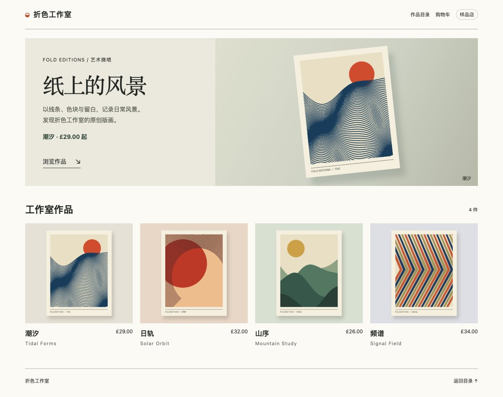

# UUCH Storefront Starter

折色工作室是第一个可独立部署的 UUCH 样品店。模板包含原创艺术印刷品、手机和桌面目录、商品详情及分规格售价。真实模式从你获批的 UUCH Business 自有网店读取已上架商品。可体验加入购物车、调整数量、游客结算及查看测试订单。



## 运行样品店

在 GitHub 点击 **Use this template → Create a new repository**。在你自己的仓库中执行以下命令，使用 Node.js 22.13 或更新版本。

```sh
npm ci
npm start
```

打开 http://127.0.0.1:4317 。默认 demo 模式展示四幅样品，离线可用。修改 `demo.mjs` 调整样品规格；`view.mjs` 和 `public/style.css` 控制展示布局和主题。`npm test` 验证目录读取和 HTTP 页面。

## 体验购买流程

打开商品详情，选择规格并确认售价，点「加入购物车」。可在购物车修改数量或移除商品，点「去结算」后使用预填的示例收货信息，核对总额并点「确认测试付款」。成功页显示测试订单号、商品和模拟实付。重复提交沿用首次结果。

样品模式默认启用模拟结算；连接真实目录时默认关闭结算。仅在隔离演示店设置 `UUCH_CHECKOUT_MODE=sandbox` 即可体验同一流程。演示免运费、税费为零，不连接支付机构，不生成 UUCH 代发单。收货表单只作测试校验，测试订单保存商品快照和金额，无邮件或物流动作。结算前重新读取店铺零售价与可用规格，变价后须重新确认。

购物车和测试订单使用模板服务器上的 SQLite，默认位置为 `.local/storefront.sqlite`，可用 `UUCH_CART_DB` 指定持久磁盘上的文件。浏览器通过本店访客 Cookie 找回自己的购物车和订单。单实例演示需要可写的本地磁盘；勿将数据库或密钥提交到 GitHub。

## 连接自己的店铺

1. 在 UUCH Business 的「自有网店」创建草稿、提交店铺审核。首批真实连接限已开通独立店铺能力的商家及已审批店铺；真实模式需要 UUCH 后端启用新版目录及相应开关。
2. 从商品库选择商品，填写公开标题、为要展示的规格输入店铺币种零售价并发布。下架后原详情地址返回 404。
3. 在该店「连接独立店面」生成专用目录密钥，复制该店的配置。运行 `cp .env.example .env.local` 并在本机编辑，或将下列值设为部署平台的服务端环境变量。

```dotenv
UUCH_STOREFRONT_MODE=live
UUCH_API_BASE_URL=https://YOUR-API-HOST/open/v1
UUCH_EXPECTED_STORE_ID=YOUR-STORE-ID
UUCH_STOREFRONT_TOKEN=YOUR-READ-ONLY-STORE-KEY
```

4. 运行 `npm run storefront:check`。核对店名、店铺编号、已发布商品数，再运行 `npm start`。生产密钥仅存服务端；轮换时先准备替换环境配置。使用错误的凭据、店铺或接口地址会报错。成功连接且商品数为 0 表示该店尚无可展示商品。
5. 部署到支持 Node 服务器的主机或容器。启动命令为 `npm start`，配置 `PORT`；直连托管网络时按主机要求配置 `HOST=0.0.0.0`。自有服务器可将反向代理转到回环地址。前方 CDN 应尊重 `Cache-Control: no-store`。访问或刷新时动态读取目录，日常改价不需要构建或重新部署。
6. 在托管项目添加自己的域名并按其实际提示配置 CNAME、A 或 AAAA 记录及 HTTPS。在 UUCH「自有网店」输入相同域名，将返回的 `_uuch-store.<域名>` TXT 名称和值复制到 DNS，再点击验证。确认店铺正确后，将 `STOREFRONT_ORIGIN` 设为该 HTTPS 域名，重启进程。正式域名必须与 UUCH 已验证的绑定一致。HTTPS 证书和指向商家服务器的 DNS 记录由托管方处理。
7. 打开自己的域名查看刚发布商品。在后台改价并刷新店面，再下架并打开旧链接。若始终看到「样品店」，请检查部署环境的模式并重启服务；若 503，运行连接检查区分鉴权、店铺编号、域名和后端可用性。

## 接口

服务端使用 `Authorization: Bearer <目录密钥>` 访问 `/open/v1/storefront/connection`、`/products` 和 `/products/{id}`（后两项沿用同一 storefront 前缀）。列表按游标分页，零售价为标注币种的最小单位。密钥只读取对应店的公开目录。真实收款、后台零售订单、会员及资金结算属于后续交易版本。

你可以复制、修改这套模板及其原创样品图，用于搭建自己的 UUCH 店面。
